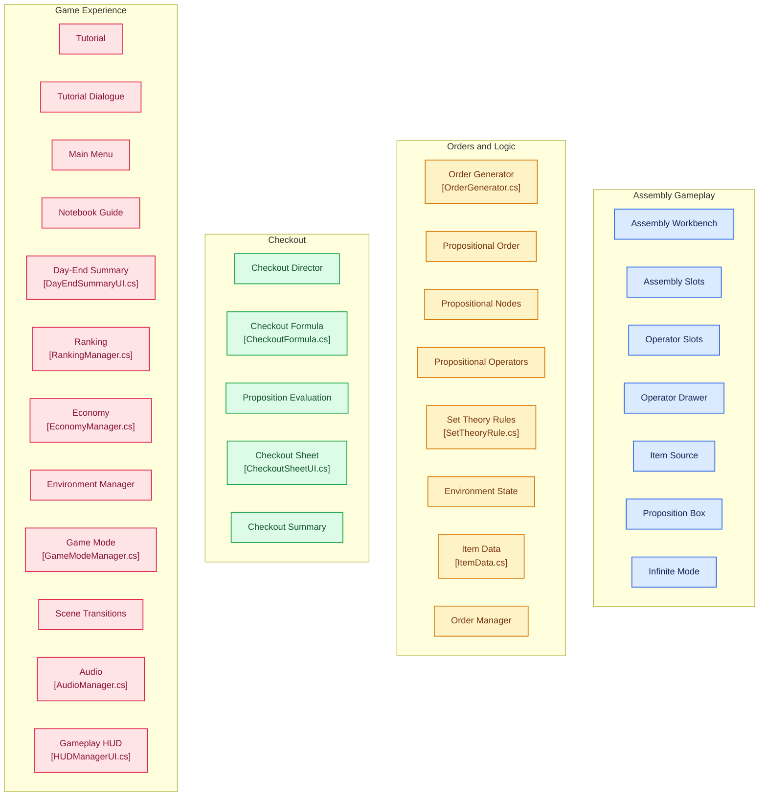
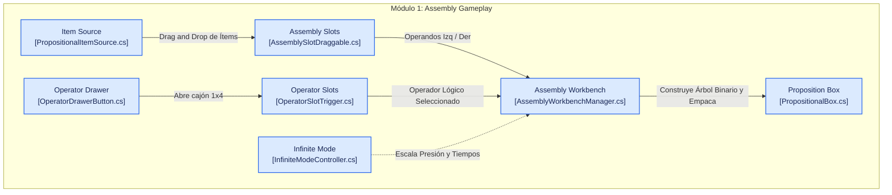
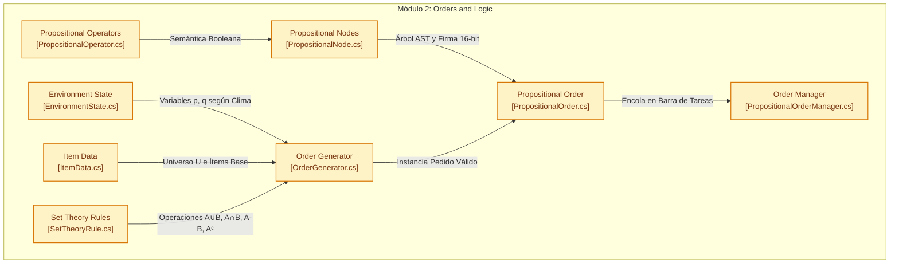
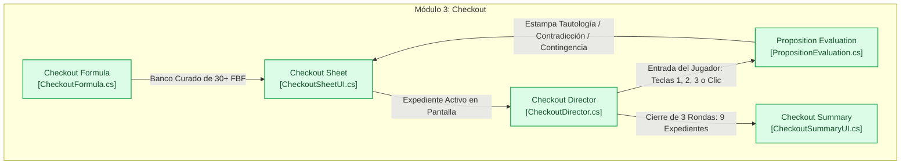

# 📦 Overpacked (LogiPack: Almacén Lógico)

<div align="center">


-blue?style=for-the-badge)


**Un videojuego 2D de simulación y lógica formal donde el almacén es tu laboratorio proposicional.**  
*Combina Teoría de Conjuntos, Árboles Sintácticos de Lógica Proposicional y Despacho Automatizado al más puro estilo de gestión diegética.*

[Ver Repositorio en GitHub](https://github.com/itsluuis/overpacked) • [Documentación de Diseño (GDD)](docs/plans/2026-10-25-cuaderno-rankings-and-navigation-design.md) • [Manual de Continuidad](GUIA_CONTINUIDAD_PROYECTO.md)

</div>

---

## 📑 Tabla de Contenidos

1. [Visión General del Proyecto](#-visión-general-del-proyecto)
2. [Fundamentación en Lógica Simbólica](#-fundamentación-en-lógica-simbólica)
3. [Arquitectura del Sistema (Diagrama General)](#-arquitectura-del-sistema)
4. [Módulos del Sistema y Flujos Dinámicos](#-módulos-del-sistema-y-flujos-dinámicos)
   - [Módulo 1: Gameplay de Ensamblaje (Assembly Gameplay)](#1-módulo-de-gameplay-de-ensamblaje-assembly-gameplay)
   - [Módulo 2: Órdenes y Lógica Formal (Orders & Logic)](#2-módulo-de-órdenes-y-lógica-formal-orders--logic)
   - [Módulo 3: Inspección y Check-out (Checkout)](#3-módulo-de-inspección-y-check-out-checkout)
   - [Módulo 4: Experiencia de Juego y Meta-Sistemas (Game Experience)](#4-módulo-de-experiencia-de-juego-y-meta-sistemas-game-experience)
5. [Catálogo Oficial de Ítems (Conjunto Universal $U = 12$)](#-catálogo-oficial-de-ítems-del-almacén)
6. [Modos de Juego](#-modos-de-juego)
7. [Controles y Ergonomía](#-controles-y-ergonomía)
8. [Instalación y Configuración](#-instalación-y-configuración)
9. [Estructura del Repositorio](#-estructura-del-repositorio)
10. [Créditos y Cátedra](#-créditos-y-cátedra)

---

## 💡 Visión General del Proyecto

**Overpacked** (previamente conocido como *LogiPack: Almacén Lógico*) es un videojuego de puzzle y gestión en 2D desarrollado en **Unity 6 (Universal Render Pipeline 2D)**. El jugador asume el rol de un operario en un centro logístico automatizado.

A diferencia de los simuladores de logística tradicionales, las órdenes de compra en Overpacked no son simples listas estáticas: son **Fórmulas Bien Formadas (FBF)** de la **Lógica Proposicional** condicionadas por estados ambientales dinámicos (lluvia, temperatura, turno), y requerimientos de clasificación derivados de la **Teoría de Conjuntos** (uniones, intersecciones, diferencias y complementos sobre familias y atributos de materiales).

> [!NOTE]
> El proyecto fue concebido y desarrollado como proyecto final de la cátedra **Lógica Simbólica** (Semestre 4, Universidad José Antonio Páez - UJAP), demostrando que los conceptos de rigor formal pueden transformarse en mecánicas jugables adictivas y didácticas.

---

## 🧠 Fundamentación en Lógica Simbólica

El núcleo matemático del juego se asienta sobre dos pilares formales:

```
                  ┌──────────────────────────────────────────┐
                  │          LÓGICA SIMBÓLICA FORMAL         │
                  └─────────────────────┬────────────────────┘
                                        │
             ┌──────────────────────────┴──────────────────────────┐
             ▼                                                     ▼
┌──────────────────────────┐                         ┌──────────────────────────┐
│   LÓGICA PROPOSICIONAL   │                         │    TEORÍA DE CONJUNTOS   │
├──────────────────────────┤                         ├──────────────────────────┤
│ • Variables: p, q, r, s  │                         │ • Conjunto Universal:    │
│ • Conectivos: ¬, ∧, ∨,   │                         │   U = 12 ítems del stock │
│   ⊕, →, ↔                │                         │ • Subconjuntos:          │
│ • Tablas de verdad       │                         │   Familias, Tiers, Flags │
│ • Firmas de 16 bits:     │                         │ • Operaciones:           │
│   Equivalencia O(1)      │                         │   A ∪ B, A ∩ B, A - B, Aᶜ│
│ • Evaluación semántica   │                         │ • Validación O(1) vía    │
│   de condiciones in-game │                         │   HashSet en memoria     │
└──────────────────────────┘                         └──────────────────────────┘
```

1. **Lógica Proposicional:**
   - **Proposiciones Atómicas:** Variables que denotan el estado ambiental o el embalaje físico de la caja:
     - $p$: El entorno está despejado (`IsClear`).
     - $q$: Está lloviendo sobre el almacén (`IsRaining`).
     - $r$: La caja posee aislamiento de espuma protectora (`BoxHasFoam`).
     - $s$: La caja está sellada con film térmico (`BoxHasThermalFilm`).
   - **Conectores Soportados:** Negación ($\neg$), Conjunción ($\land$), Disyunción inclusiva ($\lor$), Disyunción exclusiva ($\oplus$), Condicional material ($\rightarrow$) y Bicondicional ($\leftrightarrow$).
   - **Firmas Booleanas de 16 Bits:** Cada árbol de expresiones evalúa su tabla de verdad en un entero de 16 bits (`ushort`), permitiendo comparar equivalencias lógicas complejas en tiempo constante $O(1)$.

2. **Teoría de Conjuntos:**
   - **Conjunto Universal ($U = 12$):** Catálogo cerrado de 12 ítems industriales categorizados por Familias (Metales, Electricidad, Óptica, Textiles), Tiers de calidad (Tier 1 a 3) y Atributos booleanos (`Metal`, `Electrical`, `Fragile`, `Fabric`, `Tool`).
   - **Operaciones de Selección:** Pedidos corporativos que solicitan productos pertenecientes a fórmulas de conjuntos: $x \in (\text{Metales} \cup \text{Textiles}) \setminus \text{Fragile}$.

---

## 🗺️ Arquitectura del Sistema

A nivel arquitectónico, el sistema desacopla la simulación visual interactiva, la generación de órdenes procedurales, el motor de inferencia lógica y la experiencia de usuario.



---

## 🧩 Módulos del Sistema y Flujos Dinámicos

Para una comprensión profunda y mantenibilidad del código, el sistema se divide en **4 módulos funcionales interconectados**:

```
 ┌──────────────────────┐         Instancia Órdenes         ┌──────────────────────┐
 │                      ├──────────────────────────────────►│                      │
 │   ORDERS & LOGIC     │                                   │  ASSEMBLY GAMEPLAY   │
 │   (Reglas y Pedidos) │◄──────────────────────────────────┤  (Mesa y Empaquetado)│
 │                      │        Consulta de Fórmulas       │                      │
 └──────────┬───────────┘                                   └──────────┬───────────┘
            │                                                          │
            │ Valida FBF                                               │ Entrega Caja
            ▼                                                          ▼
 ┌──────────────────────┐        Resultados y Puntuación    ┌──────────────────────┐
 │                      │◄──────────────────────────────────┤                      │
 │       CHECKOUT       │                                   │   GAME EXPERIENCE    │
 │ (Auditoría Formal)   ├──────────────────────────────────►│ (Meta, HUD y Audio)  │
 └──────────────────────┘         Progreso y Modales        └──────────────────────┘
```

A continuación se detalla cada módulo con su respectivo diagrama de flujo específico, enlaces al código fuente y su explicación dinámica.

---

### 1. Módulo de Gameplay de Ensamblaje (`Assembly Gameplay`)

Este módulo orquesta la interacción física y táctil del operario en la mesa de trabajo (`Assembly Bench`), gestionando la recepción de ítems desde las estanterías, la selección de conectores lógicos mediante un cajón retráctil, y el empaquetado final de proposiciones compuestas en cajas físicas.



#### 🔄 Explicación Dinámica del Ensamblaje:
1. **Extracción y Arrastre (`PropositionalItemSource.cs`):**  
   El jugador hace clic y arrastra ítems desde las estanterías laterales hacia la mesa. Cada ítem físico representa una proposición atómica (por ejemplo, *Perno Galvanizado* con variable asignada $p$ o $q$).
2. **Recepción en Ranuras (`AssemblySlotDraggable.cs`):**  
   La mesa cuenta con una disposición de ranuras 1x3: dos ranuras de operandos (`Slot Left` y `Slot Right`) y una ranura central de conectiva. Al soltar un ítem, la ranura detecta el drop, captura el `PropositionalNode` y actualiza la previsualización visual.
3. **Selección Diegética del Conector (`OperatorDrawerButton.cs` & `OperatorSlotTrigger.cs`):**  
   Al interactuar con el cajón de madera (`cajon_1x4.png`), este se despliega suavemente mostrando los operadores disponibles ($\land, \lor, \rightarrow, \leftrightarrow$). Al hacer clic sobre uno, se transfiere a la ranura central, emitiendo el evento `OnOperatorSelected`.
4. **Construcción y Síntesis Lógica (`AssemblyWorkbenchManager.cs`):**  
   Cuando las ranuras contienen dos operandos y un operador válido, el `AssemblyWorkbenchManager` sintetiza un nuevo nodo binario:
   $$\text{NodoResultante} = \text{CreateBinary}(\text{Left}, \text{Op}, \text{Right})$$
   Calcula inmediatamente su firma de verdad de 16 bits y activa el prefab de la caja (`PropositionalBoxPrefab`).
5. **Caja Proposicional y Despacho (`PropositionalBox.cs`):**  
   La caja resultante (`PropositionalBox`) contiene los ítems ensamblados, su fórmula sintáctica y los atributos de embalaje especial (espuma protectora $\neg r$ o film térmico $s$). La caja puede ser depositada en las bandas transportadoras de despacho para su validación final.
6. **Modulación por Modo Infinito (`InfiniteModeController.cs`):**  
   En la Jornada Infinita, este ciclo se ejecuta bajo cronómetros decrecientes (iniciando en 60s hasta un suelo de 30s) y cuotas monetarias que aumentan un 18% por ronda, poniendo a prueba la velocidad de ensamblaje del jugador.

---

### 2. Módulo de Órdenes y Lógica Formal (`Orders and Logic`)

Este módulo constituye el cerebro lógico y probabilístico del juego. Administra la generación sintáctica de pedidos garantizando siempre satisfacibilidad, la resolución de álgebra de conjuntos en tiempo constante y la escucha del clima del almacén.



#### 🔄 Explicación Dinámica de la Lógica y Pedidos:
1. **Sensado del Entorno (`EnvironmentState.cs`):**  
   Mantiene el estado booleano de las variables meteorológicas del almacén (`IsClear`, `IsRaining`, `IsStorming`, `IsCold`, `IsHot`).
2. **Generación Algorítmica con Consistencia Justa (`OrderGenerator.cs`):**  
   Crea pedidos combinando proposiciones atómicas y moleculares. Mediante una regla de consistencia interna, el generador garantiza que jamás se emita una orden con condiciones mutuamente contradictorias (como exigir que llueva y no llueva a la vez en la misma hora).
3. **Representación en Árbol AST y Firma de 16 Bits (`PropositionalNode.cs`):**  
   Las fórmulas no se evalúan mediante costosos parsers de cadenas de texto en runtime. En su lugar, cada orden almacena un árbol sintáctico donde cada nodo calcula un número binario de 16 bits (`ushort`):
   ```csharp
   for (int i = 0; i < 16; i++) {
       bool p = (i & 1) != 0, q = (i & 2) != 0, s = (i & 4) != 0, r = (i & 8) != 0;
       if (Evaluate(p, q, s, r)) sig |= (ushort)(1 << i);
   }
   ```
   Si la firma de la caja del jugador coincide exactamente con la firma de la orden (`BoxSignature == OrderSignature`), la validez lógica es inmediata ($O(1)$).
4. **Cálculo de Teoría de Conjuntos (`SetTheoryRule.cs`):**  
   Resuelve operaciones de conjuntos sobre el inventario universal ($U = 12$). Al crearse un pedido de empresa (*ej. Ferretería Pim Pom Pim*), la regla resuelve el conjunto válido de artículos mediante un `HashSet<ItemData>` cacheado una única vez, evitando asignaciones de memoria o pausas del Garbage Collector.
5. **Gestor de Cola de Pedidos (`PropositionalOrderManager.cs`):**  
   Despliega los pedidos activos en las tarjetas post-it superiores, actualiza sus barras de tiempo restante y escucha los eventos de depósito en las bandas transportadoras para efectuar la entrega inmediata.

---

### 3. Módulo de Inspección y Check-out (`Checkout`)

El módulo de Checkout es la estación de auditoría analítica del almacén. En él, el jugador debe examinar expedientes con Fórmulas Bien Formadas (FBF), evaluando si una declaración es una **Tautología**, una **Contradicción** o una **Contingencia**.



#### 🔄 Explicación Dinámica de la Auditoría Formal:
1. **Banco Curado de Fórmulas (`CheckoutFormula.cs`):**  
   Dispone de un banco de más de 30 fórmulas con máximo 2 variables ($p$ y $q$), garantizando tablas de verdad de 4 filas ágiles para una rápida resolución mental:
   - *Tautologías:* $(p \land q) \rightarrow p$, $p \lor \neg p$, $(p \rightarrow q) \lor p$.
   - *Contradicciones:* $p \land \neg p$, $\neg(p \lor \neg p)$, $p \leftrightarrow \neg p$.
   - *Contingencias:* $p \rightarrow q$, $p \land q$, $\neg p \lor q$.
2. **Presentación Diegética (`CheckoutSheetUI.cs`):**  
   Organiza la sesión en un tríptico de 3 expedientes por ronda (3 rondas = 9 expedientes en total). Cada hoja muestra la fórmula simbólica y su traducción formal al lenguaje natural.
3. **Clasificación por Teclado o Mouse (`CheckoutDirector.cs`):**  
   El jugador evalúa la fórmula e ingresa su veredicto mediante botones en pantalla o atajos ergonómicos:
   - `[1]` o `[Q]`: **Tautología** (Verdadera en todas sus interpretaciones).
   - `[2]` o `[W]`: **Contradicción** (Falsa en todas sus interpretaciones).
   - `[3]` o `[E]`: **Contingencia** (Verdadera en al menos una y falsa en al menos una).
4. **Estampación Física y Retroalimentación (`PropositionEvaluation.cs`):**  
   Al seleccionar la clasificación, se reproduce una animación de sello de tinta con feedback auditivo distintivo (`CorrectSFX` o `IncorrectSFX`).
5. **Reporte Final de Calidad (`CheckoutSummaryUI.cs`):**  
   Al completar los 9 expedientes, se genera un acta de balance que califica el porcentaje de precisión lógica, tiempo promedio de respuesta y otorga prestigio profesional al operario.

---

### 4. Módulo de Experiencia de Juego y Meta-Sistemas (`Game Experience`)

Este módulo agrupa la capa de inmersión, metajuego y persistencia: el Menú Principal con el cuaderno diegético interactivo, el sistema de tutorial con Mochi Miles, la economía de propinas tricolor, el ranking local Top 5, transiciones cinemáticas y el paisaje sonoro dinámico.

```mermaid
flowchart TD
  subgraph group_experience["Módulo 4: Game Experience"]
    node_main_menu["Main Menu<br/>[MainMenuController.cs]"]
    node_notebook["Notebook Guide<br/>[GameplayNotebookGuideUI.cs]"]
    node_tutorial["Tutorial<br/>[TutorialDirector.cs]"]
    node_tutorial_dialogue["Tutorial Dialogue<br/>[TutorialDialogueUI.cs]"]
    node_game_mode["Game Mode<br/>[GameModeManager.cs]"]
    node_environment_manager["Environment Manager<br/>[EnvironmentManager.cs]"]
    node_economy["Economy<br/>[EconomyManager.cs]"]
    node_hud["Gameplay HUD<br/>[HUDManagerUI.cs]"]
    node_audio["Audio<br/>[AudioManager.cs]"]
    node_scene_transition["Scene Transitions<br/>[SceneTransitionManager.cs]"]
    node_day_end["Day-End Summary<br/>[DayEndSummaryUI.cs]"]
    node_ranking["Ranking<br/>[RankingManager.cs]"]
  end

  node_main_menu -->|"Apertura Animada de Hojas"| node_notebook
  node_notebook -->|"Selección: Tutorial / Normal / Infinita"| node_game_mode
  node_game_mode -->|"Cortina de Transición Horizontal"| node_scene_transition
  node_game_mode -->|"Inicia Turno y Música Específica"| node_audio
  node_game_mode -->|"Activa Ciclo Meteorológico"| node_environment_manager
  node_tutorial -->|"Guía Paso a Paso del Supervisor"| node_tutorial_dialogue
  node_environment_manager -->|"Actualiza Reloj y Clima"| node_hud
  node_economy -->|"Actualiza Monedas y Balance"| node_hud
  node_game_mode -->|"Fin de Turno a las 22:00 o Fallo de Cuota"| node_day_end
  node_day_end -->|"Guarda Registro Atómico Top 5"| node_ranking

  click node_tutorial "https://github.com/itsluuis/overpacked/blob/main/My%20project/Assets/Scripts/Tutorial/TutorialDirector.cs"
  click node_tutorial_dialogue "https://github.com/itsluuis/overpacked/blob/main/My%20project/Assets/Scripts/Tutorial/TutorialDialogueUI.cs"
  click node_main_menu "https://github.com/itsluuis/overpacked/blob/main/My%20project/Assets/Scripts/UI/MainMenuController.cs"
  click node_notebook "https://github.com/itsluuis/overpacked/blob/main/My%20project/Assets/Scripts/UI/GameplayNotebookGuideUI.cs"
  click node_day_end "https://github.com/itsluuis/overpacked/blob/main/My%20project/Assets/Scripts/UI/DayEndSummaryUI.cs"
  click node_ranking "https://github.com/itsluuis/overpacked/blob/main/My%20project/Assets/Scripts/Core/RankingManager.cs"
  click node_economy "https://github.com/itsluuis/overpacked/blob/main/My%20project/Assets/Scripts/Managers/EconomyManager.cs"
  click node_environment_manager "https://github.com/itsluuis/overpacked/blob/main/My%20project/Assets/Scripts/Managers/EnvironmentManager.cs"
  click node_game_mode "https://github.com/itsluuis/overpacked/blob/main/My%20project/Assets/Scripts/Core/GameModeManager.cs"
  click node_scene_transition "https://github.com/itsluuis/overpacked/blob/main/My%20project/Assets/Scripts/Managers/SceneTransitionManager.cs"
  click node_audio "https://github.com/itsluuis/overpacked/blob/main/My%20project/Assets/Scripts/Audio/AudioManager.cs"
  click node_hud "https://github.com/itsluuis/overpacked/blob/main/My%20project/Assets/Scripts/UI/HUDManagerUI.cs"

  classDef toneRose fill:#ffe4e6,stroke:#e11d48,stroke-width:1.5px,color:#881337
  class node_tutorial,node_tutorial_dialogue,node_main_menu,node_notebook,node_day_end,node_ranking,node_economy,node_environment_manager,node_game_mode,node_scene_transition,node_audio,node_hud toneRose
```



#### 🔄 Explicación Dinámica de la Experiencia y Metajuego:
1. **Menú de Escritorio y Cuaderno Interactivo (`MainMenuController.cs` & `CuadernoMenuController.cs`):**  
   Ambientado en el escritorio del supervisor con papeles y planos de almacén. Al presionar **JUGAR**, el cuaderno cerrado se desplaza al centro, se escala y ejecuta una animación de apertura frame a frame (`abrir_paso_1..4.png`).
2. **Paginación de 3 Hojas Físicas Dobles:**  
   - **Hoja 0 (Prueba Laboral / Tutorial):** Introducción de 5 competencias lógicas junto al supervisor Mochi Miles, con badge de estado (`[✓] COMPLETADA` vs `[!] PENDIENTE`).
   - **Hoja 1 (Jornada Normal):** Turno de 06:00 a 22:00 con cuotas escalonadas y tabla **Top 5** de mejores ganancias netas.
   - **Hoja 2 (Jornada Infinita):** Modo contrarreloj arcade de supervivencia con tabla **Top 5** de rondas máximas superadas.
3. **Persistencia Atómica del Ranking (`RankingManager.cs`):**  
   Guarda y serializa en formato JSON las 5 mejores puntuaciones por modo mediante `PlayerPrefs`, formateando el podio con Rich Text en colores metálicos (`#FFD700` Oro, `#D0D0D0` Plata, `#CD7F32` Bronce).
4. **Economía de Propinas Tricolor (`EconomyManager.cs`):**  
   El pago se calcula dinámicamente con bonificaciones por embalaje y conectivas lógicas, sumado a un incentivo por celeridad en la entrega:
   - 🟢 **Zona Verde ($\ge 60\%$ del tiempo):** $+25\%$ de propina.
   - 🟡 **Zona Amarilla ($25\% \le t < 60\%$):** $+10\%$ de propina.
   - 🔴 **Zona Roja ($< 25\%$):** $+0\%$ de propina (valor nominal).
5. **Paisaje Sonoro Dinámico (`AudioManager.cs`):**  
   Singleton persistente con bandas sonoras compuestas específicamente para cada contexto:
   - *Menú:* *"The Picking Floor"* (ritmo relajante de planificación y escritorio).
   - *Tutorial:* *"The Sorting Floor"* (cadencia pedagógica y constante de almacén).
   - *Jornada Infinita:* *"Operational Weight"* (ritmo industrial tenso y ascendente).
6. **Transición Cinematográfica (`SceneTransitionManager.cs`):**  
   Efectúa cortinillas negras en wipe horizontal de 1.0 segundo con `Time.unscaledDeltaTime`, asegurando fluidez incluso durante estados de pausa.

---

## 📦 Catálogo Oficial de Ítems del Almacén

El inventario de Overpacked conforma el **Conjunto Universal ($U = 12$)**, organizado en 4 estanterías temáticas y 3 niveles de valor comercial y complejidad:

| Ítem | Ubicación Estante | Familia | Tier | Precio | Atributos Lógicos (`ItemAttributes`) | Sprite |
| :--- | :---: | :---: | :---: | :---: | :---: | :--- |
| **Tornillo Estándar** | Col 0, Fila 2 (Abajo) | Metales | Tier 1 | $10 | `Metal` | `item_f1_t1_screw.png` |
| **Perno Galvanizado** | Col 0, Fila 1 (Medio) | Metales | Tier 2 | $18 | `Metal` \| `Tool` | `item_f1_t2_galv_bolt.png` |
| **Perno de Titanio** | Col 0, Fila 0 (Arriba) | Metales | Tier 3 | $28 | `Metal` \| `Tool` | `item_f1_t3_titanium_bolt.png` |
| **Cable Simple** | Col 1, Fila 2 (Abajo) | Electricidad | Tier 1 | $10 | `Electrical` | `item_f2_t1_wire.png` |
| **Enchufe Aislado** | Col 1, Fila 1 (Medio) | Electricidad | Tier 2 | $18 | `Electrical` \| `Tool` | `item_f2_t2_plug.png` |
| **Batería de Litio** | Col 1, Fila 0 (Arriba) | Electricidad | Tier 3 | $28 | `Electrical` \| `Fragile` | `item_f2_t3_battery.png` |
| **Vidrio Plano** | Col 2, Fila 2 (Abajo) | Óptica | Tier 1 | $10 | `Fragile` | `item_f3_t1_glass_pane.png` |
| **Lente Halógeno** | Col 2, Fila 1 (Medio) | Óptica | Tier 2 | $18 | `Fragile` \| `Electrical` | `item_f3_t2_halogen_lens.png` |
| **Cristal de Laboratorio** | Col 2, Fila 0 (Arriba) | Óptica | Tier 3 | $28 | `Fragile` \| `Tool` | `item_f3_t3_lab_crystal.png` |
| **Tela de Algodón** | Col 3, Fila 2 (Abajo) | Textiles | Tier 1 | $10 | `Fabric` | `item_f4_t1_cotton.png` |
| **Lona Impermeable** | Col 3, Fila 1 (Medio) | Textiles | Tier 2 | $18 | `Fabric` \| `Tool` | `item_f4_t2_tarp.png` |
| **Tejido Ignífugo** | Col 3, Fila 0 (Arriba) | Textiles | Tier 3 | $28 | `Fabric` | `item_f4_t3_fireproof.png` |

---

## 🎮 Modos de Juego

```
                           MODOS DE JUEGO DISPONIBLES
       ┌───────────────────────────────┼───────────────────────────────┐
       ▼                               ▼                               ▼
 ┌───────────────┐              ┌───────────────┐              ┌───────────────┐
 │PRUEBA LABORAL │              │JORNADA NORMAL │              │JORNADA INFIN. │
 ├───────────────┤              ├───────────────┤              ├───────────────┤
 │• Sin muerte   │              │• 06:00 a 22:00│              │• Contrarreloj │
 │• 5 lecciones  │              │• 4 min reales │              │  (60s a 30s)  │
 │• Mochi Miles  │              │• Cuotas: $350,│              │• Cuota +18%   │
 │• Desbloquea   │              │  $700, $1000  │              │  por ronda    │
 │  insignia     │              │• Calificación │              │• Racha x1.5   │
 │  de operario  │              │  de 0 a 3 ★   │              │• Supervivencia│
 └───────────────┘              └───────────────┘              └───────────────┘
```

1. **Prueba Laboral (Tutorial Guiado):**  
   Una inducción pedagógica de 4 minutos reales donde el supervisor Mochi Miles guía al jugador paso a paso en el uso de los conectores lógicos, el embalaje térmico y las operaciones de conjuntos.
2. **Jornada Normal (Simulación de Turno Laboral):**  
   Turno continuo desde las 06:00 AM hasta las 22:00 PM (15 segundos reales equivalen a 1 hora in-game). El rendimiento se evalúa al cierre de turno mediante estrellas y prestigio empresarial:
   - **0 Estrellas ($< \$350$):** *Día Pésimo* (Prestigio $-5.0\%$).
   - **⭐ 1 Estrella ($\$350 - \$699$):** *Día Normal* (Prestigio $0\%$).
   - **⭐⭐ 2 Estrellas ($\$700 - \$999$):** *Buen Día* (Prestigio $+3.0\%$).
   - **⭐⭐⭐ 3 Estrellas ($\ge \$1,000$):** *Día Excelente* (Prestigio $+7.0\% + 1.5\%$ adicional por pedido excedente).
3. **Jornada Infinita (Supervivencia Arcade):**  
   Modo competitivo por rondas sucesivas de alta exigencia. El cronómetro decae progresivamente ($60\text{s} \rightarrow 52.5\text{s} \rightarrow 45\text{s} \rightarrow 37.5\text{s} \rightarrow 30\text{s}$), la cuota monetaria escala $+18\%$ y se premian las entregas perfectas con un multiplicador de racha de $\times 1.5$.
4. **Estación de Check-out:**  
   Mini-juego de auditoría de tablas de verdad donde el jugador clasifica expedientes lógicos contra reloj.

---

## 🖱️ Controles y Ergonomía

- **Ratón (100% Control Mouse):**  
  - **Clic Izquierdo:** Selección de botones, apertura de cajones y activación de embalaje.
  - **Drag & Drop:** Arrastre de ítems desde las estanterías hacia la caja y de la caja hacia las cintas de despacho o revisión.
- **Teclado en Check-out (Atajos de Auditoría):**  
  - `[1]` o `[Q]`: Tautología.
  - `[2]` o `[W]`: Contradicción.
  - `[3]` o `[E]`: Contingencia.
- **Teclas Globales:**  
  - `[Escape]`: Abre el menú de pausa y opciones, congelando todos los temporizadores de gameplay de forma segura (`GameModeManager.IsGameplayPaused`).

---

## 💻 Instalación y Configuración

### Requisitos del Sistema
- **Motor de Videojuegos:** Unity 6 (`6000.6.5f1` o compatible).
- **Render Pipeline:** Universal Render Pipeline (URP 2D).
- **Sistema Operativo:** Windows 10/11, macOS (Apple Silicon / Intel) o Linux x64.
- **Input System:** Unity New Input System Package (`com.unity.inputsystem`).

### Pasos para Ejecutar el Proyecto
1. **Clonar el Repositorio:**
   ```bash
   git clone https://github.com/itsluuis/overpacked.git
   cd overpacked
   ```
2. **Abrir en Unity Hub:**
   - Abre **Unity Hub**.
   - Haz clic en **Add** (Añadir proyecto desde disco).
   - Selecciona la carpeta `My project`.
   - Asegúrate de seleccionar el editor **Unity 6 (v6000.6.5f1)** con soporte URP.
3. **Cargar la Escena Principal:**
   - En el explorador de proyecto de Unity, navega a:
     `Assets/Scenes/MainMenuScene.unity`
   - Presiona el botón de **Play (▶)** para iniciar el juego.

---

## 📁 Estructura del Repositorio

```text
overpacked/
├── docs/                                # Documentación de diseño, planes y GDD
│   └── plans/                           # Planes de arquitectura y decisiones
├── My project/                          # Proyecto principal de Unity
│   └── Assets/
│       ├── Art/                         # Sprites 2D, fondos y elementos de UI
│       ├── Audio/                       # Pistas de música (.mp3) y efectos (.wav)
│       ├── Scenes/                      # Escenas de Unity (.unity)
│       │   ├── MainMenuScene.unity      # Menú principal y cuaderno de modos
│       │   ├── GameplayScene.unity      # Almacén central de empaque
│       │   └── CheckoutScene.unity      # Estación de auditoría de tablas
│       └── Scripts/                     # Código fuente modular en C#
│           ├── Audio/                   # AudioManager.cs
│           ├── Checkout/                # CheckoutDirector.cs, CheckoutFormula.cs...
│           ├── Core/                    # GameModeManager.cs, RankingManager.cs...
│           ├── Gameplay/                # AssemblyWorkbenchManager.cs, PropositionalBox.cs...
│           ├── Logic/                   # PropositionalNode.cs, SetTheoryRule.cs...
│           ├── Managers/                # EconomyManager.cs, EnvironmentManager.cs...
│           ├── Orders/                  # OrderGenerator.cs, PropositionalOrder.cs...
│           ├── Tutorial/                # TutorialDirector.cs, TutorialDialogueUI.cs...
│           └── UI/                      # MainMenuController.cs, DayEndSummaryUI.cs...
├── GDD_Concepto_LogiPack.md             # Documento de Diseño de Juego (GDD)
├── GUIA_CONTINUIDAD_PROYECTO.md         # Guía de continuidad y arquitectura
└── README.md                            # Documentación oficial del repositorio
```

---

## 👥 Créditos y Cátedra

- **Desarrollo y Programación:** Luis Alejandro ([@itsluuis](https://github.com/itsluuis))
- **Cátedra:** Lógica Simbólica (Semestre 4)
- **Institución:** Universidad José Antonio Páez (UJAP) — Facultad de Ingeniería
- **Motor:** Unity Technologies

---

<div align="center">
  <sub>Desarrollado con pasión, rigor matemático y entusiasmo por el diseño de videojuegos. 📦✨</sub>
</div>
