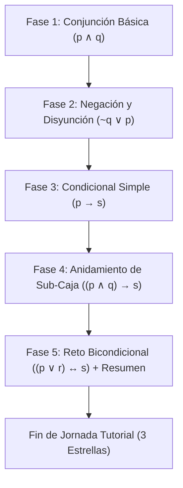

# 🎓 Diseño Oficial del Modo Tutorial: Escena Dedicada, Secuenciador y Diálogos de Mochi Miles
> **Fecha:** 25 de Octubre de 2026  
> **Proyecto:** Overpacked (LogiPack: Almacén Lógico) — Semestre 4 (Lógica Simbólica, UJAP)  
> **Motor:** Unity 6 (v6000.6.5f1) — Universal Render Pipeline (URP 2D)  
> **Estado:** Documento de Diseño Validado (Brainstorming Aprobado)

---

## 1. 🎯 Propósito y Contexto Académico

En cumplimiento con las correcciones y recomendaciones del docente de la cátedra de Lógica Simbólica, se diseña una experiencia de aprendizaje e inducción completamente dedicada, amigable y libre de estrés. 

El objetivo es enseñar progresivamente:
1. Las proposiciones atómicas ($p, q, s, r$) y sus versiones negadas ($\sim p, \sim q, \sim s, \sim r$) distribuidas en los cajones.
2. La sintaxis y lectura de Fórmulas Bien Formadas (FBF) en pedidos y su correspondencia en lenguaje natural.
3. El armado de proposiciones moleculares mediante conectivos ($\land, \lor, \rightarrow, \leftrightarrow$) en la zona 1x3.
4. Las equivalencias lógicas (conmutatividad de $\land$ y $\lor$).
5. El anidamiento recursivo de sub-cajas para construir proposiciones compuestas de múltiples niveles.

---

## 2. 📝 Registro Oficial de Decisiones de Diseño

* **Decisión 1 (Escena Dedicada):** Creación de `TutorialScene.unity` para aislar el flujo tutorial y mantener intacta `GameplayScene.unity`.
* **Decisión 2 (Alineación de Mochi Miles):** El sprite se ubica en el lateral izquierdo, anclado rígidamente a la parte inferior de la pantalla (`anchorMin = (0, 0)`, `pivot.y = 0`) para un corte natural del cuerpo. Los cambios de expresión mantienen la misma posición y escala para evitar saltos visuales.
* **Decisión 3 (Jerarquía de Modos en el Cuaderno):** En el Cuaderno de `MainMenuScene`, **TUTORIAL** se ubica en la posición superior (primera opción), seguido por **JORNADA NORMAL** (centro) y **JORNADA INFINITA** (inferior).
* **Decisión 4 (Control Híbrido de Interacción):** Pantalla pausada/bloqueada mientras Mochi habla. Al terminar la explicación y solicitar la acción, el cuadro de diálogo se retira/minimiza y se habilita la zona correspondiente con un indicador visual.
* **Decisión 5 (Cierre de Tutorial):** Reloj congelado todo el tutorial. Al entregar el 5to pedido, Mochi felicita al jugador (`cintura_ojos_cerrados`) y aparece `DayEndSummaryUI` con 3 estrellas garantizadas y botones **"REPETIR TUTORIAL"** y **"MENÚ PRINCIPAL"**.
* **Decisión 6 (Regla de los Dos Clics en Typewriter):** Si el texto se está escribiendo, un clic ejecuta *Instant Reveal* (texto completo en pantalla sin avanzar). Solo cuando el texto ya está 100% visible, un segundo clic avanza al siguiente diálogo o desbloquea la mesa.
* **Decisión 7 (Bloqueador Físico de Raycasts):** Mientras Mochi habla, se bloquea la interacción en UI y en la mesa.
* **Decisión 8 (Doble Barrera UI + Física 2D):** Además del `GraphicRaycaster` bloqueador en Canvas, se implementa corte programático directo (`canInteract = false` / validación de `EventSystem.current.IsPointerOverGameObject()`) para impedir arrastres de física 2D o colliders durante la charla.
* **Decisión 9 (Tiempo Desescalado):** `TutorialDialogueUI` opera con `WaitForSecondsRealtime` y `Time.unscaledDeltaTime`. El congelamiento del reloj en el tutorial solo pausa el avance del día en `EnvironmentManager`, sin alterar el `Time.timeScale` global.
* **Decisión 10 (Márgenes Dinámicos y Flecha Relativa):** Cajas de diálogo (`pequeno`, `mediano`, `grande`) con dimensiones y márgenes de texto calibrados, y flecha de continuación anclada al vértice inferior derecho de la caja activa.
* **Decisión 11 (Higiene de Eventos):** Desuscripción rigurosa en `OnDisable()` / `OnDestroy()` en `TutorialDirector` para permitir recargas limpias con "REPETIR TUTORIAL".
* **Decisión 12 (Micro-pasos 4A/4B y Bloqueo de Despacho Prematuro):** En la Fase 4, la sub-caja $(p \land q)$ se arma con el despacho bloqueado; solo al reintroducirla como antecedente y completar $((p \land q) \rightarrow s)$ se habilita la cinta de despacho.
* **Decisión 13 (Tolerancia Cero Frustración y Diálogo de Rescate):** Reemplazo directo de ítems u operadores arrastrando encima de las ranuras. Si el jugador intenta despachar una caja incorrecta, no se penaliza: Mochi interviene amablemente y permite corregir sin estrés.
* **Decisión 14 (HighlightFX en World Space 2D):** `TutorialHighlightFX` se implementará como un GameObject 2D en World Space (`SpriteRenderer`, `sortingOrder = 100`) para acoplarse directamente a las posiciones `Transform.position` de las ranuras, cajones y bandas transportadoras sin conversiones complejas de pantalla.
* **Decisión 15 (Mapeo Preciso del Átomo $r$):** En la Fase 5, el átomo $r$ apunta al cajón de "Tejido Ignífugo" (cuadrícula derecha, fila inferior de proposición directa), manteniendo coherencia con el diseño de la mesa.
* **Decisión 16 (Configuración Limpia de DayEndSummaryUI):** En `TutorialScene`, el botón "Siguiente Día" se desactiva explícitamente (`SetActive(false)`), dejando únicamente visibles y operativos los botones "REPETIR TUTORIAL" y "MENÚ PRINCIPAL".

---

## 3. 🏛️ Arquitectura de Scripts y Componentes

### 🔹 `TutorialDirector.cs`
* Máquina de estados que secuencia los pasos (`TutorialStep`).
* Inyecta las 5 FBFs ordenadas en `PropositionalOrderManager`.
* Congela el temporizador del día en `EnvironmentManager`.
* Notifica al bloqueador de interacciones y al indicador visual (`TutorialHighlightFX`).

### 🔹 `TutorialDialogueUI.cs`
* Panel de visualización de Mochi Miles con 3 expresiones:
  * `mochi_miles_brazos_cruzados.png` (presentación e introducciones).
  * `mochi_miles_mostrando.png` (explicaciones pedagógicas y guías).
  * `mochi_miles_cintura_ojos_cerrados.png` (autonomía y felicitaciones).
* Motor Typewriter con tiempo real desescalado (`Time.unscaledDeltaTime`).
* Selección dinámica del sprite de fondo:
  * `cuadro_dialogo_pequeno.png` ($\le 60$ caracteres).
  * `cuadro_dialogo_mediano.png` ($61$ a $140$ caracteres).
  * `cuadro_dialogo_grande.png` ($> 140$ caracteres).
* Flechita parpadeante indicadora de siguiente línea.

### 🔹 `TutorialInteractionBlocker.cs`
* Intercepta raycasts en Canvas y notifica a los componentes de mesa (`AssemblyWorkbenchManager`) para suspender el Drag & Drop durante los parlamentos.

### 🔹 `TutorialHighlightFX.cs`
* Indicador visual flotante (flecha animada / pulso) que señala el elemento requerido en cada paso.

---

## 4. 📋 Secuencia Pedagógica de las 5 Fórmulas FBF

1. **Fase 1 — $p \land q$:**
   * Mochi presenta el almacén y el rol de supervisora.
   * Explica los cajones atómicos ($p =$ Perno, $\sim p =$ Tornillo, $q =$ Batería, $\sim q =$ Cable).
   * Muestra el pedido post-it con la FBF $p \land q$.
   * Guía la colocación en Ranura 1, selección de $\land$ en el cajón 1x4, y colocación de $q$ en Ranura 3.
   * Explica la conmutatividad ($p \land q \equiv q \land p$).
   * Despacho guiado de la caja generada.
2. **Fase 2 — $\sim q \lor p$:**
   * Mochi da paso al trabajo individual.
   * El jugador usa el Cable Simple ($\sim q$) y la disyunción ($\lor$).
   * Despacho autónomo con red de seguridad.
3. **Fase 3 — $p \rightarrow s$:**
   * Mochi explica el condicional ("Si $p$, entonces $s$") y resalta que aquí el orden de las casillas sí importa.
   * Armado con antecedente ($p$) y consecuente ($s =$ Cristal de Lab).
4. **Fase 4 — $((p \land q) \rightarrow s)$:**
   * **Micro-paso 4A:** Armado de la sub-caja $(p \land q)$ con despacho bloqueado.
   * **Micro-paso 4B:** Arrastre de la sub-caja a la Ranura 1, selección de $\rightarrow$, colocación de $s$ en Ranura 3.
   * Despacho de la fórmula compuesta.
5. **Fase 5 — $((p \lor r) \leftrightarrow s)$:**
   * Mochi explica el funcionamiento del reloj (06:00 a 22:00), el dinero y el cuaderno verde de apoyo.
   * Reto autónomo con bicondicional.
   * Al despachar: felicitación de Mochi y apertura de `DayEndSummaryUI` con 3 estrellas fijas.

---

## 5. 🚪 Integración en Menú y Flujo de Escenas

* **`MainMenuScene.unity`:**
  * Cuaderno con 3 tarjetas: `TUTORIAL` (arriba), `JORNADA NORMAL` (centro) y `JORNADA INFINITA` (abajo).
  * `CuadernoMenuController.cs` actualiza títulos y sinopsis. Botón "INICIAR INDUCCIÓN ▶" carga `TutorialScene.unity`.
* **`TutorialScene.unity`:**
  * Duplicado y especialización limpia de los elementos visuales de la mesa y HUD.
  * Botón de pausa funcional y botón de cuaderno de teoría activo.
  * `DayEndSummaryUI` con botones "REPETIR TUTORIAL" (recarga `TutorialScene`) y "MENÚ PRINCIPAL" (carga `MainMenuScene`).
* **`BuildSettings`:**
  * Agregar `Assets/Scenes/TutorialScene.unity` a la lista de escenas del build.
